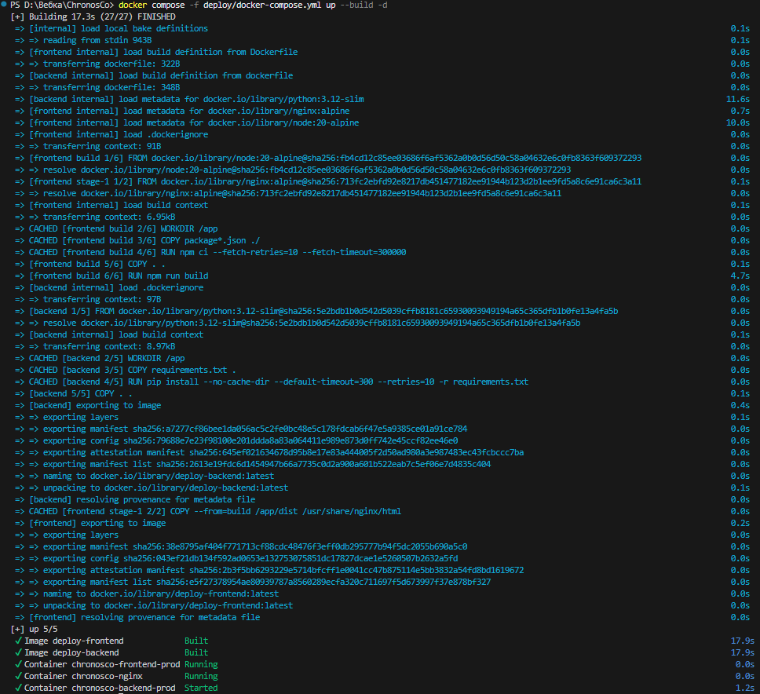
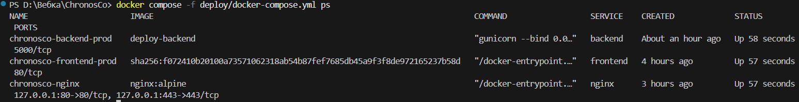
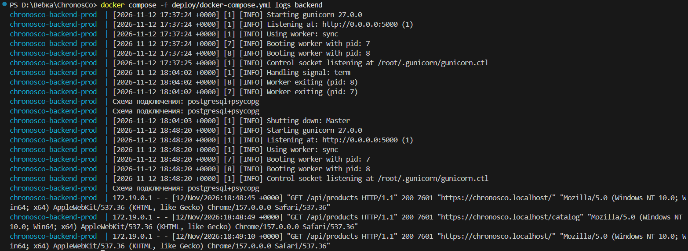
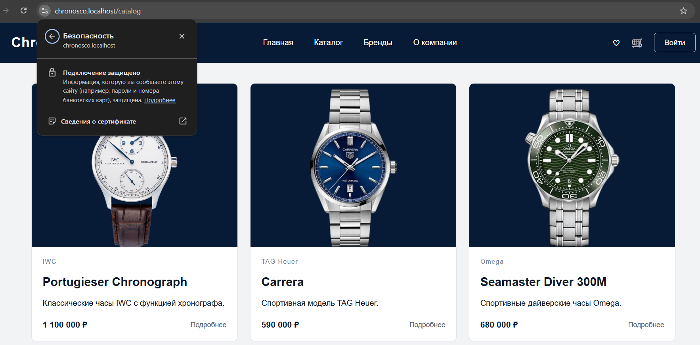
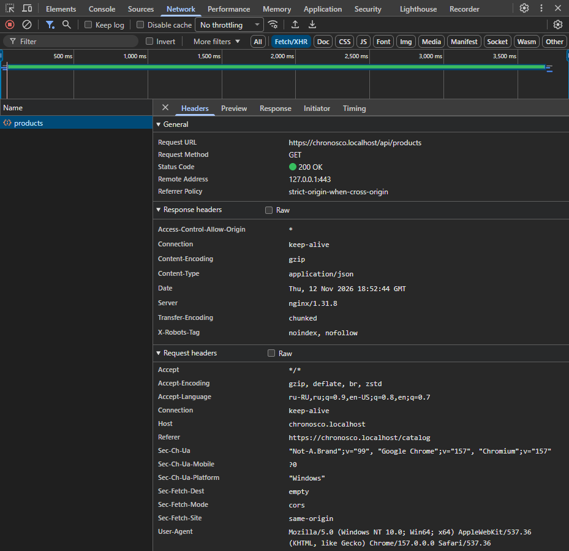
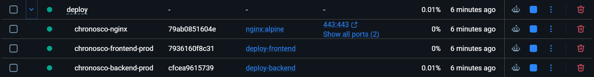
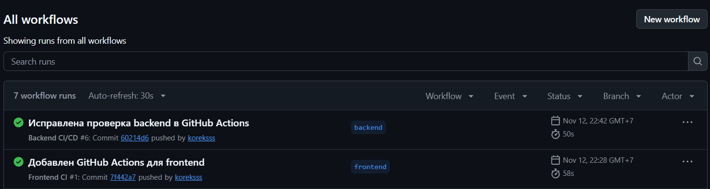

# Chronos & Co — Production Deploy

## 1. Архитектура проекта

Браузер → Nginx (HTTPS) → Frontend (React) / Backend (Flask + Gunicorn) → Supabase PostgreSQL.

Nginx принимает запросы от браузера: запросы к `/api/` перенаправляются на Backend, остальные — на Frontend. Frontend получает данные через API Backend.

## 2. Сервисы проекта

**Frontend**
- Технологии: React, TypeScript, Nginx.
- Внутренний порт: 80.
- Production-сервер: Nginx.

**Backend**
- Технологии: Python, Flask.
- Внутренний порт: 5000.
- Production-сервер: Gunicorn.

**Nginx**
- Технология: Nginx.
- Порты: 80 (HTTP), 443 (HTTPS).
- Используется для перенаправления HTTP на HTTPS и маршрутизации запросов между Frontend и Backend.

**База данных**
- Технология: Supabase PostgreSQL.
- Размещена во внешнем сервисе Supabase.

Порты 80 и 443 опубликованы только на локальном интерфейсе `127.0.0.1`. Frontend и Backend доступны через внутреннюю Docker-сеть.

## 3. Переменные окружения и секреты

- `DATABASE_URL` — строка подключения к Supabase PostgreSQL.
- `SKIP_DB_CHECK` — управление проверкой подключения к БД при выполнении CI.

Значения секретных переменных и файлы `.env` в репозиторий не добавляются.

## 4. Запуск и остановка проекта

Команды выполняются из корневой папки frontend-проекта.

**Сборка и запуск:**
```powershell
docker compose -f deploy/docker-compose.yml up --build -d
```

**Проверка состояния контейнеров:**
```powershell
docker compose -f deploy/docker-compose.yml ps
```

**Просмотр журналов:**
```powershell
docker compose -f deploy/docker-compose.yml logs
```

**Остановка проекта:**
```powershell
docker compose -f deploy/docker-compose.yml down
```

Адрес проекта: https://chronosco.localhost

## 5. Результаты запуска и проверки

### 5.1. Сборка и запуск Docker Compose

На рисунке 1 представлен результат сборки образов и запуска контейнеров проекта.

[Открыть скриншот 01-compose-build.png](screenshots/01-compose-build.png)



### 5.2. Проверка состояния контейнеров

На рисунке 2 представлен результат выполнения команды `docker compose ps`. Все три сервиса находятся в состоянии Up.

[Открыть скриншот 02-compose-ps.png](screenshots/02-compose-ps.png)



### 5.3. Журнал Backend

На рисунке 3 представлен журнал Backend, подтверждающий запуск Gunicorn и обработку запросов к API с успешным ответом HTTP 200.

[Открыть скриншот 03-backend-logs.png](screenshots/03-backend-logs.png)



### 5.4. Проверка HTTPS

На рисунке 4 представлен сайт Chronos & Co, открытый по адресу `https://chronosco.localhost`. Браузер подтверждает защищённое соединение.

[Открыть скриншот 04-https-catalog.png](screenshots/04-https-catalog.png)



### 5.5. Проверка API

На рисунке 5 представлен запрос `/api/products` во вкладке Network. Сервер вернул ответ HTTP 200 OK и заголовок `X-Robots-Tag: noindex, nofollow`.

[Открыть скриншот 05-network-api.png](screenshots/05-network-api.png)



### 5.6. Контейнеры Docker Desktop

На рисунке 6 представлен список контейнеров проекта в Docker Desktop. Внешние порты опубликованы только у контейнера Nginx.

[Открыть скриншот 06-docker-desktop.png](screenshots/06-docker-desktop.png)



## 6. Ошибки и их устранение

- Отсутствовал ODBC-драйвер в Docker — после миграции на PostgreSQL настроено подключение через `psycopg`.
- Возник конфликт порта 443 — контейнер Nginx был пересоздан.
- `curl.exe` выдавал ошибку проверки локального сертификата — для локальной проверки использовался параметр `-k`.
- GitHub Actions не мог запустить тесты из-за проверки БД при импорте — проверка перенесена в запуск приложения, для CI заданы необходимые переменные окружения.

## 7. Публикация на реальном сервере

Для публикации проекта потребуется настроить домен и DNS, заменить локальный сертификат на доверенный SSL-сертификат, открыть необходимые порты, перенести секреты в защищённое хранилище и настроить сервер для постоянной работы приложения.

## 8. GitHub Actions

Frontend CI выполняет проверку кода с помощью ESLint и сборку React-приложения.

Backend CI/CD запускает тесты, собирает Docker-образ и публикует его в GitHub Container Registry (GHCR).

На рисунке 7 представлен результат успешного выполнения GitHub Actions для Frontend и Backend.

[Открыть скриншот 07-github-actions.png](screenshots/07-github-actions.png)

